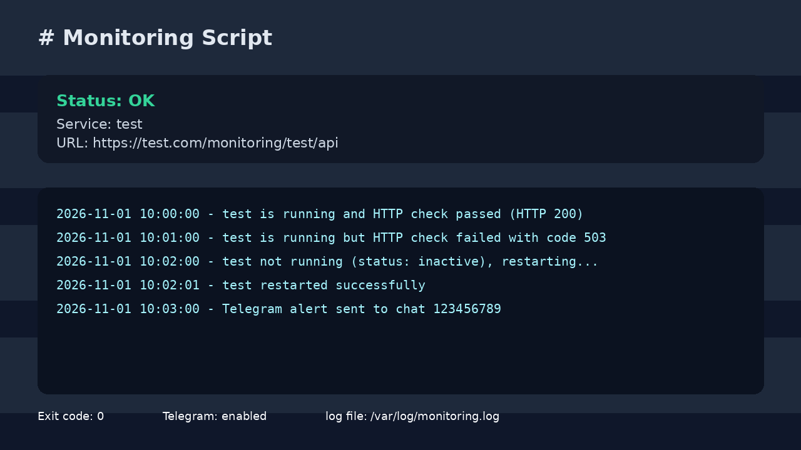

# Monitoring Script

Monitoring for the `test` process with logging, HTTP checks, and Telegram alerts.

## What the script checks
- Verifies the `test` service state with `systemctl is-active`.
- Performs an HTTPS check against `https://test.com/monitoring/test/api`.
- Writes events to `/var/log/monitoring.log`.
- Automatically attempts `systemctl restart test` if the process is down.
- Sends a Telegram message if the bot token and chat ID are configured.
- Returns proper exit codes for automation via cron, systemd, or CI.

## Exit codes
- `0` — the service is active and the HTTP check succeeded.
- `1` — the service was inactive and/or the restart failed.
- `2` — the service is active, but the HTTP check failed.
- `3` — the Telegram notification failed to send.

## Telegram alerting
To enable Telegram notifications, set the variables before starting the service:

```bash
sudo systemctl edit monitor-test.service
```

Then add:

```ini
[Service]
Environment=MONITOR_URL=https://test.com/monitoring/test/api
Environment=TELEGRAM_BOT_TOKEN=123456:ABCDEF
Environment=TELEGRAM_CHAT_ID=123456789
```

After that, reload the service configuration:

```bash
sudo systemctl daemon-reload
sudo systemctl restart monitor-test.service
```

If these variables are not set, Telegram alerts are simply skipped and the monitoring continues to work normally.

## Installation

1. Copy the script to a system directory:

```bash
sudo cp monitor-test.sh /usr/local/bin/monitor_test.sh
sudo chmod +x /usr/local/bin/monitor_test.sh
```

2. Enable the systemd units:

```bash
sudo cp monitor-test.service /etc/systemd/system/
sudo cp monitor-test.timer /etc/systemd/system/
sudo systemctl daemon-reload
sudo systemctl enable --now monitor-test.timer
```

3. Check the timer status:

```bash
sudo systemctl status monitor-test.timer
sudo journalctl -u monitor-test.service -f
```

## Example logs

Example contents of `/var/log/monitoring.log`:

```text
2026-11-01 10:00:00 - test is running and HTTP check passed (HTTP 200)
2026-11-01 10:01:00 - test is running but HTTP check failed with code 503
2026-11-01 10:02:00 - test not running (status: inactive), restarting...
2026-11-01 10:02:01 - test restarted successfully
```

## Removing the systemd service

To fully remove the monitoring setup:

```bash
sudo systemctl disable --now monitor-test.timer
sudo rm -f /etc/systemd/system/monitor-test.service
sudo rm -f /etc/systemd/system/monitor-test.timer
sudo rm -f /usr/local/bin/monitor_test.sh
sudo systemctl daemon-reload
sudo systemctl reset-failed
sudo rm -f /var/log/monitoring.log
```

## Screenshot of the result


